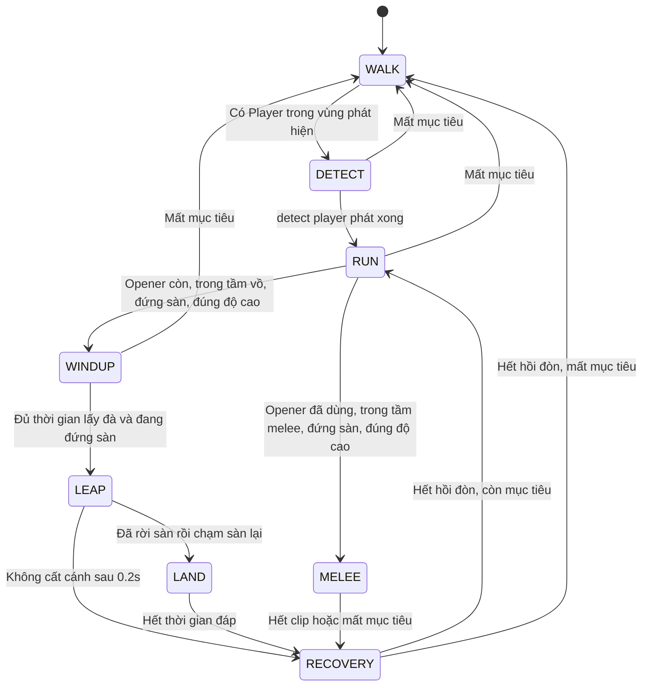

# BÁO CÁO KỸ THUẬT — HỆ THỐNG ENEMY

> Debug enemy 16/10/2026: Esc → Debug - Enemies có Disable enemy AI và Invincible enemies, áp dụng EnemyBase/Wobtear/SpineEnemy theo phiên debug, không ghi save. Chi tiết phạm vi, cleanup và kiểm chứng: [enemy_debug_pause_report.md](enemy_debug_pause_report.md).

> Cập nhật 16/10/2026: SpineEnemy chết trên không vẫn rơi theo physics Player, dùng collider địa hình riêng và tiếp tục death/fade gốc; hurtbox/hitbox gốc vẫn tắt. Các mô tả corpse đứng yên/tắt toàn bộ physics bên dưới là lịch sử. Chi tiết hiện hành: [enemy_death_report.md](enemy_death_report.md).

**Dự án:** Sojourn: Echoes of the Soul  
**Repository:** Liebe-dev/soujourn--echoes-of-the-soul  
**Ngày lập:** 14/10/2026  
**Đối tượng:** EnemyBase, Wobtear M1, SpineEnemy và các thay đổi tương tác với Adel.  
**Nguồn kiểm tra:** working tree tại `D:/Godot Project/soujourn--echoes-of-the-soul`, nhánh `main`, HEAD `84feb3fd78fbe05969af63397480f7c32b58205d`. Working tree có thay đổi chưa commit; HEAD không đại diện cho toàn bộ nội dung được mô tả. Không kiểm tra trạng thái đồng bộ GitHub trong lượt lập báo cáo này.

## 1. Kết quả hiện tại và phạm vi báo cáo

Hệ thống hiện có hai enemy được triển khai theo hai bước phát triển khác nhau:

1. **Wobtear M1:** enemy tối thiểu dùng `AnimatedSprite2D`, có tuần tra walk/idle, vật lý sàn/tường, nhận sát thương, chết và thưởng EXP. Mục tiêu của M1 là kiểm chứng nền tảng tương tác chiến đấu; Wobtear này chưa có phát hiện Player hoặc chủ động tấn công.
2. **SpineEnemy:** enemy chiến đấu dùng rig có sẵn trong `enemy_spine.tscn`, kế thừa phần HP/chết/EXP từ EnemyBase. Hành vi gồm walk, chuyển tiếp detect player, run đuổi Player, nhảy vồ mở đầu bằng ba pose `attack1_*`, sau đó dùng `attack2` và đôi khi `attack3`.

Các lần chỉnh sửa sau đó đã xử lý hitbox phía trước VFX, hitbox riêng cho nhảy vồ, cho Player đi/dash xuyên thân quái, đặt toàn bộ hình quái phía trước Player, và tập trung quyết định Guard/Deflect ở phía Player. Chi tiết hệ thống phòng thủ, stamina, stagger và các sửa lỗi trạng thái Player được tách sang báo cáo riêng dẫn ở mục 10; báo cáo này giữ phần giao tiếp enemy–Player.

**Trong lượt lập báo cáo:** chỉ bổ sung tài liệu và gói bằng chứng. Không chỉnh gameplay, animation, rig, asset, prototype hoặc audio. Đã chạy lại năm bộ kiểm thử enemy bằng Godot 4.7 trên bản sao có dữ liệu lưu riêng: **175 kiểm tra, 0 thất bại**. Phân biệt kết quả này với các kiểm thử đã chạy ở những lượt trước tại mục 13.

## 2. Danh mục file và trách nhiệm

### 2.1. Enemy mới

- `res://scenes/enemy/enemy_base.gd`: lớp `EnemyBase`, kế thừa `CharacterBody2D`. Quản lý HP, tuần tra cơ bản, animation sprite, API nhận đòn, chết và EXP.
- `res://scenes/enemy/wobtear_enemy.tscn`: cấu hình Wobtear M1, SpriteFrames và collider. Dùng trực tiếp EnemyBase; không cần script Wobtear riêng.
- `res://scenes/enemy/enemy_test.tscn`: sân thử Wobtear, gồm Player thật, sàn và hướng dẫn điều khiển.
- `res://scenes/enemy/spine_enemy.gd`: kế thừa EnemyBase; điều khiển AI chiến đấu, chọn animation, hướng nhìn, hai vùng gây sát thương và chống đánh lặp trong một swing.
- `res://scenes/enemy/spine_enemy.tscn`: scene gameplay của SpineEnemy, gồm thân vật lý, rig hiển thị, hitbox melee và hitbox leap.
- `res://scenes/enemy/spine_enemy_test.tscn`: sân thử SpineEnemy, dùng Player thật và sàn.
- `res://scenes/enemy/enemy_spine.tscn`: scene rig nguồn được instance vào `spine_enemy.tscn`. Root là `Node2D`; animation sử dụng `AnimationPlayer` và rig xương 2D. Tên scene không đồng nghĩa với việc đã triển khai một hệ thống combat riêng của plugin Spine.
- `res://tests/enemy/leap_hitbox_validation.gd` và `.tscn`: bộ kiểm thử được giữ trong repo cho hitbox vồ và tương tác phòng thủ.

### 2.2. File liên quan đến giao chiến

- `res://scenes/adel/components/saber_hitbox.gd`: hitbox Saber, cửa sổ đánh và chống trúng lặp; gửi `take_damage()` đến enemy.
- `res://scenes/adel/playable_adel.gd`: nhận sát thương từ enemy, quyết định phòng thủ, điều phối trạng thái Player, đi xuyên thân quái và phản ứng stagger.
- `res://scenes/adel/components/defense_component.gd`: trạng thái phòng thủ, thời gian giữ, phân loại NONE/DEFLECT/GUARD và ngân sách bật lùi Guard.
- `res://scenes/adel/components/damage_component.gd`: phản ứng stagger, stun, i-frame và kiểm tra vòng đời node trước timer/callback.
- `res://scenes/adel/components/adel_state_machine.gd`: HFSM của Player; dọn trạng thái/queue/hitbox khi đòn đánh bị ngắt.
- `res://scenes/adel/components/deflect_slow_motion.gd`: pulse thay đổi `Engine.time_scale`, khôi phục khi hết thời gian hoặc Player rời cây scene.
- `res://scenes/UI/stats_component.gd` và `ui.gd`: HP, threshold, debuff, stamina và cập nhật HUD. Enemy không tự ghi trực tiếp các chỉ số này.
- `res://scenes/Mechanic/player_progress.gd`: nhận EXP và xử lý tăng cấp/điểm nâng cấp.

### 2.3. Legacy được giữ lại

Hai prototype `res://scenes/enemy/enemy.gd` (`EnemyPrototype`) và `res://scenes/testing/Enemies/enemy.gd` (`EnemyPrototypeTesting`) vẫn tồn tại. Không thay thế toàn bộ chúng bằng EnemyBase và không xóa các scene thử cũ.

Vũ khí thử nghiệm `res://scenes/testing/Enemies/enemy_weapon.gd` được sửa có chủ đích để cả đòn thường và đặc biệt đều gửi damage qua Player. `res://scenes/testing/Enemies/enemy.tscn` kết nối cả `Hitbox` và `SpecialHitbox` vào cùng callback. Đây là chuẩn hóa giao tiếp combat, không phải nâng cấp toàn bộ AI legacy.

Rà soát tham chiếu scene hiện tại cho thấy hai enemy mới được instance trực tiếp trong các scene test tương ứng. Không thấy tham chiếu trực tiếp đến `spine_enemy.tscn` hoặc `wobtear_enemy.tscn` trong các file scene/map đã tìm kiếm; vì vậy không tuyên bố chúng đã được triển khai vào toàn bộ map hoặc main scene. Nạp scene động bằng đường dẫn được ghép tại runtime không được loại trừ chỉ bằng tìm kiếm văn bản này.

## 3. Kiến trúc và phân chia trách nhiệm

```text
CharacterBody2D
└── EnemyBase
    ├── wobtear_enemy.tscn: dùng hành vi tuần tra cơ bản
    └── spine_enemy.gd: kế thừa HP/chết/EXP, thay vòng lặp AI bằng FSM combat

Enemy attack area → PlayableAdel.take_damage()
                  → DefenseComponent / StatsComponent / DamageComponent
                  → HFSM + animation của Player

SaberHitbox → EnemyBase.take_damage() → EnemyBase.die() → PlayerProgress.add_exp()
```

SpineEnemy dùng **FSM phẳng gồm tám trạng thái**, chưa phải HFSM. EnemyBase cũng chưa được chia thành các component health/perception/combat độc lập; nó là lớp nền tối thiểu, còn SpineEnemy điều phối AI, presentation và damage window trong một script. HFSM/component đã có phía Adel không đồng nghĩa với enemy đã sử dụng cùng kiến trúc.

Cách triển khai hiện tại giữ hợp đồng giao tiếp nhỏ: enemy cần có `take_damage(dmg, hit_from_global)` để nhận đòn; Player cần thuộc group `Player` và có `take_damage()` để nhận damage từ SpineEnemy. Phòng thủ thuộc quyền quyết định của bên nhận đòn, giúp một quy tắc áp dụng được cho mọi kiểu attack của enemy.

## 4. EnemyBase và Wobtear M1

### 4.1. Khởi tạo và tuần tra

Khi `_ready()`, EnemyBase đặt `current_health` từ `max_health`, lưu `_anchor_x` theo vị trí spawn, chuẩn hóa hướng ban đầu thành -1 hoặc +1 và bắt đầu trạng thái walking. `_anchor_x` không được cập nhật theo mỗi bước di chuyển nên phạm vi tuần tra không trôi dần.

Trong `_physics_process(delta)`, enemy chịu trọng lực khi chưa đứng sàn, đếm thời gian để đổi walk/idle, và di chuyển ngang bằng `move_and_slide()`. Biên tuần tra là `anchor_x ± patrol_range`; `patrol_range = 200` nghĩa là vùng rộng 400 đơn vị, không phải tổng rộng 200.

Tốc độ trong mỗi bước bị giới hạn theo khoảng cách còn lại đến biên, tránh vượt biên do bước vật lý lớn. Khi walking và chạm tường, enemy đổi hướng. Đây là tuần tra ngang đơn giản; chưa có nhận biết mép vực hoặc điều hướng quanh chướng ngại vật.

Nếu thiếu `CollisionShape2D`, thiếu shape hoặc collider đang disabled, EnemyBase phát cảnh báo và tắt physics processing. Đây là bảo vệ khởi tạo, không phải cơ chế tự sửa scene.

### 4.2. Animation và asset Wobtear

Hai PNG `Wobtear1.png` và `Wobtear2.png` đã được khôi phục từ Git theo lựa chọn của người dùng sau khi bị xóa ở commit `1b6195a`. Chỉ khôi phục hai ảnh idle/walking phục vụ M1; không khôi phục hoặc hoàn thiện attack/death legacy ngoài phạm vi đó.

`wobtear_enemy.tscn` tạo SpriteFrames riêng:

- `idle`: hai frame, vùng atlas 128 × 128 tại x=128 và x=256 của `Wobtear1.png`; loop, 5 FPS.
- `walking`: sáu frame 128 × 128 từ x=0 đến x=640 của `Wobtear2.png`; loop, 5 FPS.
- Sprite nằm tại `(-3, -18)`, scale `(1.5, 1.5)`; texture filter cấu hình nearest.
- Collider capsule: radius 49.5, height 99, tâm local `(-1.5, 0)`.
- Ảnh gốc hướng trái; script dùng `flip_h` để nhìn theo hướng di chuyển.

Nếu tên animation được yêu cầu thiếu hoặc không có frame, EnemyBase thử animation đầu tiên có frame. Khi toàn bộ SpriteFrames rỗng thì dừng sprite. AnimatedSprite2D là tùy chọn đối với lớp nền; thiếu sprite không làm mất hợp đồng HP/chết.

### 4.3. Thông số Wobtear đang có hiệu lực

- HP: **20**; EXP: **30**.
- Speed: **150 đơn vị/giây**; patrol range: **±200** quanh điểm spawn.
- Walk duration: **5 giây**; idle duration: **5 giây**.
- Initial direction: **phải**; animation `idle` / `walking`.
- Body layer bitmask **4** (enemy/layer 3); mask **1** (world/layer 1).
- Không gắn group `Enemy` trong scene mới; không kích hoạt nhánh damage tiếp xúc legacy của Player qua group này.

Mặc dù AnimatedSprite2D lưu `animation = idle` trong scene, `_ready()` bắt đầu walking theo thiết kế. Giá trị được thấy khi mở scene trong editor không nhất thiết là animation đầu tiên khi chạy.

Wobtear M1 chưa phát hiện/đuổi Player, chưa có đòn chủ động, hitbox tấn công, hit reaction, knockback hoặc death animation. Không suy diễn hành vi SpineEnemy sang Wobtear chỉ vì cả hai dùng EnemyBase.

## 5. SpineEnemy: scene gameplay và rig hiển thị

```text
SpineEnemy (CharacterBody2D, script spine_enemy.gd)
├── CollisionShape2D                  — thân vật lý / vùng bị Saber truy vấn
├── VisualPivot                       — mirror hình theo hướng
│   └── EnemyRig                      — instance enemy_spine.tscn
│       └── AnimationPlayer           — clip nguồn
├── WeaponPivot                       — mirror hitbox melee theo hướng
│   └── Hitbox (Area2D)
│       └── CollisionShape2D          — vùng VFX của attack2/attack3
└── LeapHitbox (Area2D)
    └── CollisionShape2D              — vùng gây damage theo thân khi nhảy vồ
```

HP lưu trong wrapper là **100**, ghi đè default 20 của EnemyBase. Walk speed lưu trong wrapper là **80**, ghi đè default 150 của lớp nền. EXP vẫn là 30. Các export kế thừa `walk_duration`, `idle_duration`, `animation_idle`, `animation_walk` vẫn tồn tại trong Inspector nhưng không điều khiển chu kỳ walk/idle của SpineEnemy vì script con thay vòng lặp vật lý và chọn clip riêng.

Rig instance có Position **(-267, -236.9)**, Scale **(0.3, 0.3)**. Scale này áp dụng cho nhánh hiển thị; collider và hai hitbox nằm ngoài nhánh EnemyRig nên không tự giảm còn 30% theo scale rig.

Khi khởi tạo, script kiểm tra rig/AnimationPlayer, WeaponPivot/Hitbox và LeapHitbox, cùng tám clip walk/detect/run/combat cần thiết. Thiếu cấu trúc hoặc clip thì cảnh báo và tắt AI. Hai node hỗ trợ authoring `Sprite2D` / `Sprite2D2` ở rig nguồn được ẩn trên instance gameplay nếu có.

## 6. FSM và hành vi chiến đấu của SpineEnemy



### 6.1. WALK

Phát `walk`, đi liên tục trong vùng tuần tra quanh `_anchor_x`. SpineEnemy không nghỉ idle theo chu kỳ 5/5 giây của Wobtear. Gặp tường trong WALK thì đổi hướng. Sau khi đuổi xa, trở về tuần tra theo mốc gốc bằng chuyển động vật lý, không teleport về spawn.

### 6.2. Phát hiện và RUN

`_refresh_target()` chọn Node2D gần nhất thuộc group `Player` trong **500** đơn vị. Phát hiện dùng khoảng cách Euclid giữa hai origin, chưa có kiểm tra đường nhìn hoặc góc nhìn, nên có thể phát hiện xuyên tường.

Khi đã có mục tiêu, enemy giữ mục tiêu trong phạm vi **650** đơn vị. Nếu mục tiêu ở ngoài phạm vi này liên tục **1.5 giây game time**, target bị bỏ; quay lại gần trong khoảng đó sẽ reset bộ đếm. Ngưỡng bỏ mục tiêu thực tế dùng `max(disengage_distance, detection_distance)` để không nhỏ hơn vùng phát hiện.

Khi WALK phát hiện target, enemy chuyển sang **DETECT**, nhìn về phía Player và
phát `detect player` một lần. Trong pha này vận tốc ngang bằng 0; gravity/world
collision vẫn chạy, cả hai vùng damage đều đóng và opener chưa bị tiêu thụ.
Không bỏ qua pha detect kể cả khi Player đã đứng trong tầm leap/melee.

Clip hiện dài **0.7 giây game**. Chuyển sang RUN dựa trên signal
`AnimationPlayer.animation_finished` của chính clip này, nên đổi độ dài,
speed_scale, pause/resume hoặc global time scale sẽ giữ nhịp theo playback thực.
Clip chuyển tiếp cần giữ non-loop để có sự kiện kết thúc.

Mất/freed target theo luật target hiện tại trong DETECT thì trở về WALK, không
đợi hết clip và không chạy tiếp theo một target không hợp lệ. Khi giao chiến mới
được phát hiện từ WALK, detect phát lại; RECOVERY trong cùng giao chiến vẫn về RUN
trực tiếp và không phát detect cho mỗi đòn. Callback chỉ xử lý khi enemy còn sống,
ở trong tree và vẫn thuộc DETECT, tránh completion cũ ghi đè trạng thái khác.

RUN phát `run`, quay về phía target, đuổi ngang với speed **240**. Chuyển sang đòn đánh còn yêu cầu đứng sàn và chênh lệch độ cao giữa hai origin không quá **100**. Vì không có pathfinding, RUN không tự nhảy qua tường, mép vực hoặc tìm đường đến Player ở nền cao khác.

### 6.3. WINDUP → LEAP → LAND: đòn mở đầu

Mỗi giao chiến bắt đầu với `opener_available = true`. Khi khoảng cách ngang đến Player ≤ **280**, enemy có thể vào WINDUP:

1. **WINDUP:** phát pose `attack1_1`, đứng lấy đà **0.4 giây**. Không mở vùng damage. Khi target bị giải phóng/mất thì trở về WALK.
2. **LEAP:** khi đủ thời gian và đang đứng sàn, `_launch()` quay lại phía target lần cuối, tiêu thụ opener, đặt vận tốc lên **420** và vận tốc ngang tính theo vị trí target tại thời điểm phóng. Phát `attack1_2`, mở LeapHitbox.
3. **LAND:** chỉ vào sau khi enemy đã rời sàn thật rồi `move_and_slide()` xác nhận đứng sàn lại. Phát `attack1_3`, đóng các damage area, giữ **0.35 giây**, sau đó vào RECOVERY.

Vận tốc ngang dùng ước lượng thời gian bay `2 × jump_speed / gravity_y`, rồi lấy chênh lệch x chia thời gian đó; giới hạn trong **±520**. Đây là ước lượng quỹ đạo cho cao độ tương đương, chưa giải nghiệm đáp chính xác lên nền khác độ cao. Vận tốc ngang được chốt khi phóng; enemy không tự bám x mới của Player trong lúc bay. Player có thể né bằng thay đổi vị trí sau khi enemy phóng.

Nếu va chạm/trần thấp khiến enemy không rời sàn trong hơn **0.2 giây** của LEAP, script chuyển sang RECOVERY để tránh kẹt trạng thái vồ. Nếu mất target khi đang bay, damage window đóng nhưng chuyển động vật lý tiếp tục; không có teleport hoặc hủy trọng lực.

Với `reset_opener_on_disengage = true`, khi mất mục tiêu opener được cho lại để giao chiến sau mở bằng vồ. Khi tắt, một enemy chỉ dùng opener một lần trong vòng đời sau lần phóng đầu tiên. Đây là lựa chọn gameplay có thể chỉnh.

### 6.4. MELEE và RECOVERY

Sau opener, khi khoảng cách ngang ≤ **110** và đúng điều kiện sàn/độ cao, `_begin_melee()` chọn:

- `attack2`: lựa chọn thông thường, **12 damage**, clip **0.7 giây**, active window **[0.30, 0.45)** giây.
- `attack3`: xác suất **0.2 mỗi lần chọn đòn**, **18 damage**, clip **0.9 giây**, active window **[0.40, 0.65)** giây.

`attack3_chance` là xác suất độc lập mỗi lần chọn; không phải bắt buộc cứ năm đòn có một attack3. Có thể đặt 0 hoặc 1 để kiểm thử hai trường hợp xác định.

MELEE không di chuyển ngang theo target và không đổi sang leap giữa đòn. Hết thời lượng clip, hoặc mất target, thì sang RECOVERY. RECOVERY đóng damage window, giữ enemy đứng theo vật lý, chờ **0.7 giây** rồi về RUN/WALK. Trạng thái này không phát clip riêng; tư thế cuối của đòn/đáp trước đó có thể còn hiển thị đến khi state mới chọn animation.

## 7. Animation, hướng nhìn và dụng ý run

Các clip nguồn đã được đọc lại bằng Godot:

- `walk`: 2.0 giây, loop.
- `run`: 1.0 giây, loop.
- `attack1_1`, `attack1_2`, `attack1_3`: mỗi clip 0.05 giây, không loop; dùng như pose của từng pha lấy đà/bay/đáp. Độ dài clip không quyết định thời gian lấy đà hoặc thời gian bay.
- `attack2`: 0.7 giây, không loop.
- `attack3`: 0.9 giây, không loop.
- `detect player`: 0.7 giây, không loop; được dùng trong DETECT để chuyển WALK → RUN.
- `death`: 10.0 giây; phát ngay khi HP về 0, giữ fade gốc và giải phóng enemy khi clip kết thúc (cập nhật 2026-10-15).
- `RESET`: clip reset 0.001 giây của rig; không phải một state AI combat.

Rig và hitbox melee được author ở hướng trái. `_update_facing()` đặt Scale X của cả VisualPivot và WeaponPivot thành +1 khi nhìn trái, -1 khi nhìn phải. Nhờ mirror hai nhánh cùng nhau, hitbox phía trước đổi phía theo hình quái. LeapHitbox nằm ở root và giữ offset của thân, không mirror qua WeaponPivot.

**Dụng ý đã chốt của người dùng:** hình run nhanh đến mức không chạm đất. Không tự hạ hình xuống để ép chân chạm sàn. Thân vật lý vẫn chịu trọng lực và đứng sàn; vị trí hình có thể cao hơn collider theo mỹ thuật.

`animation_offsets` trong **scene hiện tại đều bằng (0,0)** cho walk, run, attack1_1, attack1_3, attack2, attack3. Script vẫn có dictionary default chứa offset Y khác 0 từ phương án căn chỉnh cũ; scene override mới là giá trị có hiệu lực trên instance này. Nếu tạo scene khác chỉ gắn script mà không mang override, các default cũ có thể có hiệu lực lại. `attack1_2` và `detect player` không có entry và nhận offset mặc định ZERO qua `.get()`.

`_set_animation()` đặt `rig.position = _rig_origin + offset` và `advance(0)` để áp pose ngay khi đổi state. Do vậy, không nên chỉ kéo Position của EnemyRig qua Remote Inspector giữa lúc chạy: lần đổi clip tiếp theo có thể ghi lại vị trí theo origin đã lưu và dictionary. Hãy chỉnh scene được lưu hoặc các offset theo clip.

Damage window melee được tính từ `_elapsed` của FSM, không đọc `AnimationPlayer.current_animation_position`. Hiện hai đồng hồ đi cùng tốc độ game mặc định. Nếu sau này chỉnh riêng `AnimationPlayer.speed_scale` hoặc thời lượng clip, cần kiểm tra/căn lại active window; thay tốc độ clip một mình có thể khiến VFX lệch thời điểm damage.

## 8. Collider, hurtbox và hai hitbox tấn công

### 8.1. Collider thân và vai trò nhận damage

`SpineEnemy/CollisionShape2D` là **collider của CharacterBody2D**, dùng cho sàn/tường. Hiện SaberHitbox phát hiện body này qua layer enemy rồi gọi `take_damage()`, vì vậy nó đồng thời là vùng bị đánh trong cơ chế đang có.

Chưa có một Area2D Hurtbox riêng hoặc hurtbox theo từng bone. Nói nó là “hurtbox” chỉ đúng theo vai trò nhận đòn hiện tại; về cấu trúc, nó vẫn là body collider. Tắt collider để cho Player đi xuyên sẽ làm thay đổi cả vật lý world và khả năng Saber truy vấn body, nên giải pháp đi xuyên được thực hiện bằng collision exception/mask, không tắt collider thân.

Body hiện dùng capsule **radius 76, height 152**, tâm **(-5,-25)**. Vì height bằng hai lần radius, hình này đang ở giới hạn dạng tròn của capsule. Những giá trị này nằm ở root gameplay, không nằm dưới scale 0.3 của EnemyRig.

### 8.2. Hitbox melee phía trước VFX

`WeaponPivot/Hitbox/CollisionShape2D` dùng RectangleShape2D:

- Position: **(-114.5, -55)** khi author hướng trái.
- Size: **(231, 170)**.
- Biên hình học local x khoảng **[-230, 1]**, y **[-140, 30]**. Đây là vùng chủ yếu phía trước, không phải toàn thân enemy.
- Khi nhìn phải, WeaponPivot mirror Scale X nên vùng chính chuyển sang bên phải.
- Dùng chung cho `attack2` và `attack3`, chỉ mở trong active window của đòn đang chọn.

Việc trúng còn phụ thuộc kích thước collider Player; tầm bắt đầu MELEE 110 không đồng nghĩa mọi vị trí trong 110 đều chắc chắn trúng, và phần mở rộng 230 của hitbox không làm AI tự bắt đầu MELEE ở 230. Vùng này là hộp bao VFX do người dùng căn, chưa phải kiểm tra theo pixel hoặc theo lưỡi/vệt chém từng frame.

### 8.3. Hitbox vồ riêng theo thân

`LeapHitbox/CollisionShape2D` dùng một **CapsuleShape2D độc lập**, khởi tạo cùng radius 76, height 152 và tâm (-5,-25) như body. Nó gây damage gần thân quái khi đang bay, bao gồm vùng trước và sau, thay vì dùng phần VFX kéo dài phía trước của hai đòn melee.

Hai shape Body và Leap không dùng chung resource. Đổi kích thước Leap không làm đổi collider world; đổi Body cũng không tự cập nhật Leap. Khi muốn chúng tiếp tục giống nhau, phải căn cả hai hoặc bổ sung cơ chế đồng bộ trong một thay đổi sau này.

LeapHitbox mở trong **LEAP / attack1_2**, damage **20**. WINDUP / attack1_1, LAND / attack1_3 và RECOVERY không gây contact damage từ area này. Player ở sau enemy vẫn có thể bị thân vồ chạm; khả năng đỡ phụ thuộc vị trí origin enemy so với hướng Player, không phụ thuộc việc contact nằm ở phần trước/sau của collider quái.

### 8.4. Layer/mask và enable/disable

`project.godot` đặt tên layer: 1 world, 2 player, 3 enemy, 4 player_weapon, 5 enemy_weapon, 6 enemy_interact. Số thứ tự layer khác giá trị bitmask:

- Body enemy: layer bitmask **4** = layer 3; mask **1** = world.
- Hitbox melee và leap: layer bitmask **16** = layer 5; mask **2** = player; `monitorable = false`, nhưng vẫn có thể monitor body.
- Saber Area2D: layer **8** = player_weapon; mask **4** = enemy.
- Body Adel: layer **3** = world + player, không phải “chỉ layer 3”.

Hai damage shape mặc định disabled. `_set_damage_window()` chọn một `_active_hitbox` theo state; LEAP chọn LeapHitbox, MELEE chọn VFX Hitbox, các state khác không chọn area. Shape được bật/tắt bằng `set_deferred()` để không sửa collider trực tiếp giữa pha xử lý vật lý.

Các cờ logic `_window_open`, `_active_hitbox` đổi ngay, nên callback không được phép gây damage chỉ vì shape chưa kịp disabled ở cuối frame. Mỗi lần chuyển state đều đóng window trước khi mở area phù hợp cho state mới.

## 9. Luồng gây/nhận sát thương và chống hit lặp

### 9.1. Enemy đánh Player

Thứ tự chính trong physics tick là: cập nhật target/state/velocity → cập nhật damage window → `move_and_slide()` → xử lý overlap damage → bổ sung kiểm tra biên leap → mới chuyển LAND nếu đã đáp.

`_try_hit_body()` chỉ xử lý body hợp lệ, chưa queued for deletion, thuộc group `Player` và có method `take_damage`. Nó đăng ký `instance_id` vào `_hit_targets` **trước** khi gọi `body.take_damage(_swing_damage, global_position)`.

Registry được xóa khi bắt đầu một leap hoặc melee mới. Mỗi Player được gọi damage tối đa một lần trong cùng swing, kể cả đứng overlap nhiều frame hoặc rời rồi quay lại. Nhiều Player có thể mỗi người nhận một contact riêng. Contact đã bị Guard/Deflect/dash/i-frame từ chối vẫn được tính là đã xử lý; enemy không thử lại khi i-frame hết trong cùng swing.

Damage window phụ thuộc việc target còn hợp lệ, nhưng body thực sự trúng không bị giới hạn `body == target`. Bất kỳ Player hợp lệ trong area có thể trúng; target điều khiển quyết định đuổi/đánh và hướng, không phải danh sách duy nhất được nhận damage.

### 9.2. Bổ sung shape query ở hai biên của leap

Danh sách overlap của Area2D được cập nhật theo tick vật lý. Bật area rồi đọc ngay có thể chưa thấy Player đang nằm trong vùng; contact chỉ phát sinh ở bước đáp cuối cũng có thể bị mất nếu LAND đóng window trước khi xử lý.

Giải pháp hiện tại dùng `PhysicsShapeQueryParameters2D` với shape/transform/mask thật của LeapHitbox, detect body và loại trừ RID của chính enemy. Direct query được bổ sung khi mở leap và khi xác nhận đáp sau khi đã rời sàn; thông thường khoảng **hai lần mỗi leap**, không phải query theo từng bone/pixel mỗi frame. Kết quả đi qua cùng `_try_hit_body()` nên overlap và direct query không cộng damage hai lần.

Đây không phải swept collision cho toàn bộ quãng đường giữa hai tick. Nếu về sau vận tốc rất cao hoặc target/collider rất mỏng, enemy vẫn có thể đi xuyên một vùng nằm hoàn toàn giữa hai vị trí lấy mẫu. Chưa triển khai quét liên tục hoặc chứng minh không tunneling ở mọi tốc độ cấu hình.

### 9.3. Player đánh enemy, chết và EXP

SaberHitbox có `_attack_active` và registry riêng, gửi lượng damage được chốt từ WeaponData khi bắt đầu swing. Saber hiện lưu Damage=20; combo 1/2/3 dùng damage cơ bản, combo 4 nhân Combo Finisher Multiplier=1.2 (24 mặc định). Player jump attack dùng hitbox riêng và default damage 20, một lần cho mỗi enemy trong cả fall/land. Xem `Context/Bao_cao_ky_thuat/combat_damage_tuning.md` để chỉnh damage và HP. Các hệ số damage gây của Fracture chưa tự được áp thêm trong đường này.

EnemyBase bỏ qua damage ≤0 hoặc khi `is_dead`, giảm HP tối thiểu về 0, gọi `die()` khi hết HP. Tham số origin được giữ để tương thích API nhưng enemy chưa dùng nó để knockback/hit reaction.

`die()` đặt `is_dead = true`, HP 0, dừng physics rồi thưởng EXP một lần. Bước `_finish_death()` mặc định vẫn queue_free ngay cho EnemyBase/Wobtear. SpineEnemy ghi đè bước này: vào DEAD, đóng damage, tắt hurtbox/hitbox/collision/AI, bỏ lock-on và phát death gốc 10 giây; chỉ queue_free khi clip hoàn tất. Stun Q không được bật lại corpse. Reset/reload map tạo enemy mới, không lưu death vào save. Chi tiết tại [enemy_death_report.md](enemy_death_report.md). `PlayerProgress.add_exp(30)` có thể tiêu EXP vào tăng cấp nên EXP còn hiển thị không nhất thiết tăng đúng 30.

## 10. Giao tiếp với hệ thống phòng thủ của Player

SpineEnemy chỉ gửi `Player.take_damage(damage, enemy.global_position)` cho cả leap,
attack2 và attack3. Vũ khí legacy cũng gửi cùng API cho normal/special attack;
`decision` chỉ chọn hitbox, không quyết định đòn nào được Guard/Deflect.

Các luật Defense/Guard/Deflect, animation, stagger threshold, stamina, phản ứng
thiếu stamina, slow motion và các sửa lỗi trạng thái Player đã được **tách sang
báo cáo riêng**:
[Báo cáo Defense / Guard / Deflect / Stagger / Stamina](<D:/Godot Project/soujourn--echoes-of-the-soul/Context/Bao_cao_ky_thuat/defense_guard_deflect_stagger_stamina_report.md>).

Phía enemy vẫn giữ registry một contact cho mỗi Player trong một swing, kể cả khi
damage bị phòng thủ/i-frame từ chối. Enemy không tự sửa HP/stamina, không tự mở
khóa Player và hiện không bị stagger ngược sau khi Player Deflect thành công.

## 11. Đi xuyên thân quái và thứ tự hiển thị

### 11.1. Đi/dash xuyên nhưng vẫn đánh nhau được

Player tắt enemy layer trong body collision mask, thêm collision exception **hai chiều** với các enemy đang tồn tại và enemy spawn sau đó. Nhận diện enemy body dựa trên layer enemy, group Enemy hoặc damage API của body không phải Player; vì vậy cần duy trì ý nghĩa của các dấu hiệu này khi bổ sung actor mới.

CollisionShape2D của enemy vẫn bật để đứng sàn và được Saber truy vấn. Các Area2D combat vẫn có mask phù hợp và tiếp tục overlap body; collision exception giữa hai CharacterBody2D không có nghĩa tắt hitbox attack. Dash vẫn có i-frame phía Player nên contact trong swing có thể được enemy ghi nhận nhưng không trừ HP.

Vì Player cũng có bit world trong collision layer, chỉ bỏ enemy khỏi mask Player chưa chắc giải quyết cả phía enemy vốn collide world. Hai chiều exception giữ cả hai body không đẩy nhau, không đứng lên thân nhau. Sàn/tường vẫn chặn theo world mask. Kết thúc Dash không bật lại va chạm thân quái.

### 11.2. Player hoàn toàn ở phía sau hình quái

`SpineEnemy.z_index = 100` đặt toàn bộ nhánh hiển thị enemy phía trước Player trong cấu trúc CanvasItem hiện tại. Các bộ phận trong rig có z_index riêng để xếp nội bộ; không cần sửa lại toàn bộ thứ tự bone/sprite chỉ để Player nằm phía sau enemy.

Z-order là thứ tự vẽ, không quyết định collision hoặc khả năng `take_damage()`. Do đó Player vẫn đánh trúng và bị đánh trúng dù bị hình enemy che. Nếu thêm một bộ phận có `z_as_relative = false`, CanvasLayer khác hoặc Z tuyệt đối cao ở Player, cần kiểm tra lại thứ tự hiển thị; root z_index không phải bảo đảm bất biến trước mọi thay đổi cấu trúc về sau.

## 12. Vị trí chỉnh sửa cho người thiết kế

### 12.1. Chỉnh HP, EXP, AI và damage

Mở `res://scenes/enemy/spine_enemy.tscn`, chọn root **SpineEnemy**:

- **Health:** Max Health 100, Exp Reward 30.
- **Patrol:** Speed 80, Patrol Range 200, Initial Direction. Walk/Idle Duration kế thừa không tạo idle ở SpineEnemy.
- **Detection:** Detection Distance 500, Disengage Distance 650, Chase Memory 1.5, Reset Opener On Disengage true, Run Speed 240.
- **Opening Leap:** Leap Range 280, Windup Time 0.4, Jump Speed 420, Max Leap Speed 520, Landing Time 0.35, Leap Damage 20.
- **Follow-up Attacks:** Melee Range 110, Attack Height Tolerance 100, Attack3 Chance 0.2, Recovery Time 0.7, Attack2 Damage 12, Attack3 Damage 18, Attack2 Window (0.3,0.45), Attack3 Window (0.4,0.65).
- **Rig Alignment:** Animation Offsets theo từng clip; scene hiện lưu ZERO, giữ dụng ý run không chạm đất.

Muốn chỉnh riêng một enemy được đặt trong map/scene test thì chọn **instance Enemy** ở scene chứa nó; override instance có thể ghi đè wrapper/default script. Muốn đổi cho mọi instance mặc định thì chỉnh wrapper được lưu. Save và chạy lại scene sau khi chỉnh, không nhầm Remote Inspector với cấu hình được lưu.

### 12.2. Chỉnh hình, collider và damage area

- Hình tổng thể: `SpineEnemy/VisualPivot/EnemyRig` → Transform → Position/Scale.
- Pose từng animation: mở `enemy_spine.tscn` → AnimationPlayer → clip và track Sprite2D/Skeleton2D tương ứng. Chỉnh scene nguồn ảnh hưởng mọi instance dùng cùng nguồn.
- Collider world/vùng nhận Saber: `SpineEnemy/CollisionShape2D` → Transform/Shape.
- Damage vồ: `SpineEnemy/LeapHitbox/CollisionShape2D` → Position, Radius, Height. Chỉnh riêng, không đổi Body resource.
- Damage attack2/attack3: `SpineEnemy/WeaponPivot/Hitbox/CollisionShape2D` → Position, Shape Size. Author ở phía trái; script tự mirror khi nhìn phải.
- Thời điểm gây damage melee: Attack2 Window / Attack3 Window trên root, theo giây game; cần nằm trong độ dài clip và đầu window nhỏ hơn cuối window.
- Thứ tự enemy trước Player: root SpineEnemy → Ordering → Z Index = 100.

Muốn chỉnh Wobtear thì mở `wobtear_enemy.tscn` và chọn root WobtearEnemy; các điều khiển walk/idle, SpriteFrames và collider của Wobtear khác rig/attack của SpineEnemy.

### 12.3. Quy trình căn hitbox

1. Chạy `spine_enemy_test.tscn` bằng F6, bật Debug → Visible Collision Shapes.
2. Xem cả hai hướng trái/phải; kiểm tra attack2/attack3 tại frame có VFX và vùng thân trong leap.
3. Căn Position/Shape trước, rồi căn active window với VFX. Không đổi scale toàn root để chữa lệch riêng hitbox, vì root scale ảnh hưởng thêm vật lý và hình.
4. Kiểm tra Player trước, sau, đang đi xuyên thân, đang Dash và đang Guard/Deflect; không chỉ quan sát một ảnh overlap trong editor.
5. Save cấu hình, chạy lại. Với leap, kiểm tra mở vùng khi đã overlap và contact ở frame đáp cuối.

Khoảng cách/radius/size trong tài liệu là đơn vị local/world của Godot trong cấu hình scale hiện tại, thường tương ứng pixel thiết kế. Camera zoom hoặc scale root của instance có thể đổi kích thước nhìn thấy hoặc kích thước world thực tế.

## 13. Kiểm thử, bằng chứng và giới hạn nghiệm thu

### 13.1. Chạy lại khi lập báo cáo — 14/10/2026

Godot **4.7.stable.official.5b4e0cb0f** đã thực sự chạy headless trên bản sao working tree. Không tắt autoload, không thay code enemy/Player để làm các kiểm tra qua. Bản sao bật custom user directory **CodexEnemyReport20261014** để không dùng dữ liệu save thật của người dùng.

Năm suite đều exit code 0, không có SCRIPT ERROR/Parse Error trong log cuối:

- **M1 — 19 kiểm tra:** scene Wobtear load, world physics, tuần tra và animation, API damage, swing Saber thật, damage không hợp lệ, chết/EXP một lần.
- **Spine AI — 23 kiểm tra:** walk/run, phát hiện, ba pose theo bay/đáp thực tế, opener, attack2/3 với xác suất 0/1, cửa sổ damage, một hit mỗi swing, mất/freed target, death/EXP.
- **Front hitbox — 37 kiểm tra:** hộp VFX và mirror trái/phải, attack2/attack3 gây damage phía trước, vị trí phía sau không dùng phần mở rộng melee, tương thích chuỗi hành vi.
- **Leap hitbox — 79 kiểm tra:** shape độc lập/cùng thân ban đầu; trước/sau/hai hướng; chỉ đúng area mở; WINDUP/LAND/RECOVERY không damage; overlap khi mở; contact cuối flight/đáp thực tế; chống lặp và reentry; nhiều Player; target bị free; Guard/Deflect qua Player thật; death cleanup.
- **Passthrough — 17 kiểm tra:** collision exception hai chiều, đi xuyên trái/phải, Dash xuyên và không bật lại body collision, enemy spawn sau Player, giữ vật lý world và khả năng trao đổi damage.

**Tổng chạy lại: 175 kiểm tra, 0 thất bại.** Một số kiểm thử dùng input/Area2D và vật lý thật; một số dùng fixture chủ động đặt state/position hoặc gọi method để kiểm tra biên. Không mô tả toàn bộ suite là chơi thủ công hoặc giao chiến tự nhiên từ đầu đến cuối.

Kiểm kê scene/clip cũng đã được chạy bằng scene Node thông thường để xác nhận export có hiệu lực, collision mask mặc định và độ dài clip; dữ liệu được lưu trong `enemy-report-inventory.json` của gói bằng chứng.

### 13.2. Bằng chứng từ các lượt triển khai trước

Các lượt trước đã chạy bản có render và lưu ảnh walk/run/windup/leap/landing/attack2/attack3, VFX hitbox, leap hitbox và ordering Player sau enemy. Chúng là bằng chứng hình ảnh tại thời điểm từng thay đổi được nghiệm thu, không thay thế kiểm thử render lại sau mọi lần căn rig của người dùng.

Lượt chỉnh stamina gần nhất đã chạy **369 kiểm tra headless và 94 kiểm tra có render**, gồm các tương tác phòng thủ, HFSM, leap, stagger/attack và respawn. Các số này có suite trùng với báo cáo hiện tại; **không cộng chúng thành số test case độc lập duy nhất**.

Tài liệu và log gốc nằm trong các gói `M1-verification.zip`, `Spine-verification.zip`, `Front-hitbox-verification.zip`, `Leap-hitbox-verification.zip`, `Actor-order-verification.zip`, `Player-passthrough-verification.zip`, `Zero-stamina-verification.zip` ở workspace outputs. Báo cáo hiện tại kèm gói `Enemy-technical-report-evidence.zip` chứa log chạy lại, kiểm kê, checksum và một số ảnh tham khảo đã có.

### 13.3. Điều chưa được xác nhận

- Chưa thực hiện lượt chơi thủ công cân bằng toàn bộ combat trong lượt báo cáo này.
- Chưa có số liệu profiler để kết luận đạt ngân sách CPU/memory với số lượng enemy lớn, FPS thấp hoặc nhiều Player.
- Chưa nghiệm thu đầy đủ mọi map, mọi legacy scene hoặc mọi build xuất game.
- Cảnh báo Bone2D từ rig đang có vẫn xuất hiện. Scene testing legacy từng có lỗi thiếu animation `walk` và node `WeaponPivot`; việc bảo tồn legacy không có nghĩa các lỗi này đã được sửa.
- Một thử nghiệm kiểm kê bằng custom SceneTree/script trực tiếp trong lượt này gặp native crash signal 11 ở lúc khởi động. Đã chuyển kiểm kê sang scene Node tiêu chuẩn và chạy thành công. Chưa xác định nguyên nhân crash của cách khởi chạy phụ trợ; không quy nó cho AI enemy, cũng không sử dụng lượt lỗi đó làm bằng chứng nghiệm thu. Năm scene kiểm thử enemy tiêu chuẩn nêu trên đều chạy hoàn tất.
- Các vấn đề addon/FM0D/import đã được ghi trong bàn giao trước không được sửa khi tạo enemy hoặc viết báo cáo. Không tuyên bố toàn dự án “không còn lỗi”.

### 13.4. Chạy kiểm thử an toàn và thử tay

Để chạy tự động, dùng một bản sao project có custom user directory riêng. Các suite EXP/death/respawn có thể tác động progression/save trong môi trường test. `res://tests/enemy/leap_hitbox_validation.tscn` đã nằm trong repo; harness M1/AI/front/passthrough nằm trong gói bằng chứng/workspace, không phải tất cả đều được commit dưới `tests/`.

Để thử gameplay, mở `enemy_test.tscn` hoặc `spine_enemy_test.tscn` và F6. A/D di chuyển, Space nhảy, chuột trái đánh; nút Guard/Deflect theo Input Map `guard and deflect`. Dùng scene Spine để xem run/vồ/melee, ra xa để kiểm tra disengage, vào lại để kiểm tra opener reset. Với Wobtear HP 20 và Saber 20, một swing đúng vùng có thể giết ngay; tăng Max Health trên instance nếu cần quan sát nhiều đòn.

## 14. Giới hạn kỹ thuật và phần việc tiếp theo được đề xuất

Những mục dưới đây là **đề xuất, chưa được triển khai hoặc tự động coi là scope đã duyệt**:

1. **Nghiệm thu cảm giác combat:** người thiết kế chốt tầm phát hiện, nhịp lấy đà, vùng vồ, tầm VFX, xác suất attack3 và cooldown. Các giá trị export hiện tại là tuning cấu hình, không phải chứng minh cân bằng đã hoàn thành.
2. **Đồng bộ animation/damage window khi retime:** quyết định tiếp tục dùng giây FSM hay chuyển marker/callback theo clip. Hiện thay speed_scale riêng cần căn lại; window đầu ≥ cuối hoặc cuối vượt độ dài clip chưa có validate đầy đủ trong editor.
3. **Hit reaction cho enemy:** death đã được nối với clip gốc 10 giây, tắt collider và giữ EXP một lần (2026-10-15); các phản ứng trúng đòn chưa có yêu cầu riêng vẫn là phần việc tiếp theo.
4. **Perception/navigation:** nếu cần, thêm line of sight, kiểm tra mép vực, giải pháp tường/nền cao và điều kiện mất mục tiêu. Không thêm tự động chỉ vì đã có RUN.
5. **Damage scaling của Player:** Saber đã đọc WeaponData.damage và có hệ số combo thứ 4; jump có damage export riêng. Rà soát các hệ số debuff/nâng cấp trước khi nối thêm scaling. Enemy damage có export riêng; các luồng cần được kiểm tra độc lập.
6. **Hurtbox độc lập nếu cần:** chỉ tách Area2D Hurtbox khi gameplay cần khác body collider, nhiều vùng/bone hoặc armor. Khi tách, phải cập nhật Saber query/API thay vì chỉ thêm node mà giữ truy vấn body cũ.
7. **Độ tin cậy tốc độ cao:** đánh giá swept collision cho leap nếu tăng tốc độ hoặc thu nhỏ collider. Direct query tại opening/landing hiện không bao phủ liên tục toàn quãng bay.
8. **Nhiều enemy:** profiler trước khi tối ưu. Target acquisition hiện duyệt group Player khi target trống; active melee/leap dùng overlap list và registry, direct shape query thường hai lần/leap. `intersect_shape()` hiện không truyền max_results riêng; trường hợp nhiều collider/Player đông cần kiểm tra giới hạn truy vấn thay vì giả định nhận đủ mọi body.
9. **Cấu trúc mở rộng:** khi thêm nhiều loại enemy, cân nhắc tách health/perception/attack configuration và logic damage-window thành component dùng chung; không bắt buộc refactor HFSM cho enemy hiện tại nếu số hành vi vẫn nhỏ. Duy trì API nhận damage và kiểm thử biên trước/sau refactor.
10. **Tích hợp map và kiểm thử lưu trong repo:** chọn vị trí spawn/điểm checkpoint, chuẩn hóa harness AI/front/passthrough vào `tests/enemy/`, và bổ sung test reset opener khi cấu hình false. Không xóa prototype để thực hiện các bước này.

## 15. Chỉ mục source và tài liệu đối chiếu

- [EnemyBase — nhận damage](<D:/Godot Project/soujourn--echoes-of-the-soul/scenes/enemy/enemy_base.gd:79>) và [chết/EXP](<D:/Godot Project/soujourn--echoes-of-the-soul/scenes/enemy/enemy_base.gd:88>).
- [SpineEnemy — physics/FSM](<D:/Godot Project/soujourn--echoes-of-the-soul/scenes/enemy/spine_enemy.gd:96>), [phát hiện target](<D:/Godot Project/soujourn--echoes-of-the-soul/scenes/enemy/spine_enemy.gd:169>) và [phóng leap](<D:/Godot Project/soujourn--echoes-of-the-soul/scenes/enemy/spine_enemy.gd:214>).
- [Chọn damage area](<D:/Godot Project/soujourn--echoes-of-the-soul/scenes/enemy/spine_enemy.gd:262>), [query biên leap](<D:/Godot Project/soujourn--echoes-of-the-soul/scenes/enemy/spine_enemy.gd:286>), [registry và gửi damage](<D:/Godot Project/soujourn--echoes-of-the-soul/scenes/enemy/spine_enemy.gd:296>).
- [Wrapper gameplay](<D:/Godot Project/soujourn--echoes-of-the-soul/scenes/enemy/spine_enemy.tscn>), [rig nguồn](<D:/Godot Project/soujourn--echoes-of-the-soul/scenes/enemy/enemy_spine.tscn>), [Wobtear](<D:/Godot Project/soujourn--echoes-of-the-soul/scenes/enemy/wobtear_enemy.tscn>).
- [Saber gửi damage](<D:/Godot Project/soujourn--echoes-of-the-soul/scenes/adel/components/saber_hitbox.gd:37>), [Player nhận damage](<D:/Godot Project/soujourn--echoes-of-the-soul/scenes/adel/playable_adel.gd:271>) và [thiết lập passthrough](<D:/Godot Project/soujourn--echoes-of-the-soul/scenes/adel/playable_adel.gd:518>).
- [Vũ khí legacy dùng chung Defense](<D:/Godot Project/soujourn--echoes-of-the-soul/scenes/testing/Enemies/enemy_weapon.gd:36>), [test leap lưu trong repo](<D:/Godot Project/soujourn--echoes-of-the-soul/tests/enemy/leap_hitbox_validation.gd>).
- Tài liệu liên quan: `Context/Bao_cao_ky_thuat/leap_hitbox.md`, `defense_guard_deflect_stagger_stamina_report.md`, `guard_stamina.md`, `adel_hfsm.md`. `guard_def.md` là báo cáo/kế hoạch ở thời điểm trước triển khai; các mô tả animation và luật cũ trong đó không được dùng thay cho code/scene hiện tại.

Các line number và giá trị trong báo cáo là ảnh chụp source ngày 14/10/2026. Khi code tiếp tục thay đổi, ưu tiên nội dung file và override scene mới nhất; cập nhật báo cáo cùng các test tương ứng.

### Cập nhật chuyển tiếp phát hiện — 14/10/2026

Thêm state DETECT và dùng clip nguồn `detect player`, WALK → DETECT → RUN.
Giữ nguyên scene wrapper/rig nguồn, run floating, collider, hitbox, HP và damage.
Test `tests/enemy/enemy_detect_validation.tscn` kiểm tra hai hướng, hết clip,
slow motion, tốc độ clip, pause/resume, target loss/free, tái giao chiến và death.
Suite leap đã bổ sung DETECT vào các state phải không gây damage. Các kết quả
chạy lại nằm trong gói Enemy-detect-transition-verification.zip của workspace.

Kiểm chứng cập nhật DETECT: Godot 4.7 chạy thực trong bản sao dùng user data riêng; 183 checks headless và 33 checks có render, 0 failures. Các cảnh báo Bone2D hiện có và cảnh báo thiếu clip của fixture kiểm thử cấu hình sai được ghi nhận; không sửa rig/asset trong lượt này.
